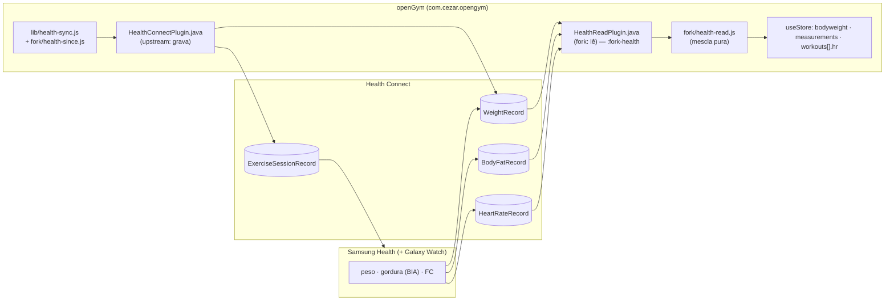

# Design: Health Connect nos dois sentidos

> Spec `fork-health` · Fase 2 · Requisitos: `requirements.md`
> Status: **aprovado em 2026-10-14**

## 1. Visão geral



A gravação (HW) é a do upstream, com o filtro `since` já implementado. A leitura (HR) é toda nova
e fica isolada: um plugin nativo do fork e um módulo JS do fork. O upstream ganha só duas linhas
marcadas `FORK`: uma no Settings, outra no `main.jsx`.

## 2. Nativo: `HealthReadPlugin` (módulo `:fork-health`)

- **Módulo** `frontend/android/fork-health/` (biblioteca Android, **Java**, como o plugin do
  upstream, usando a mesma `androidx.health.connect:connect-client` 1.1.0-alpha12 e `runBlocking`
  num worker). Entra pelo `fork-settings.gradle` e pelo `fork-app.gradle`. O `MainActivity`
  ganha mais uma linha `registerPlugin(HealthReadPlugin.class)` (bloco FORK).
- **Manifest do módulo** (mesclado): `READ_WEIGHT`, `READ_BODY_FAT`, `READ_HEART_RATE`,
  `READ_HEALTH_DATA_HISTORY`.
- **Métodos** (`registerPlugin('HealthRead')`):

| Método | Entrada | Saída |
|---|---|---|
| `status()` | — | `{ status, granted: { weight, bodyFat, heartRate, history } }` |
| `requestPermissions({ kinds })` | `['weight','bodyFat','heartRate','history']` | `{ granted: {...} }` |
| `readSince({ kinds, since, until })` | `since`/`until` em ms (`since` 0 = tudo o que for liberado) | `{ weights: [{ t, kg, origin, clientId }], bodyFat: [{ t, pct, origin, clientId }] }` |
| `heartRate({ start, end })` | intervalo de um treino | `{ samples: [[t, bpm], …] }` (resumido no JS) |

- Paginação com `pageToken` (limite de 5.000 por página). Leitura em ordem crescente de tempo.
- `origin` = `metadata.dataOrigin.packageName`, e `clientId` = `metadata.clientRecordId`. O
  filtro de "não ler o que eu gravei" fica no JS, para ser testável (HR-1.2).
- Android < 9 / Health Connect ausente → `status: 'unsupported' | 'missing'`, como o plugin do
  upstream.

## 3. JS: `frontend/src/fork/health-read.js` (puro) + `health-read-sync.js` (efeitos)

### 3.1 Funções puras (testadas)

```js
// registros de fora do openGym: ignora origem com.cezar.opengym(.test) e clientId "opengym-*"
foreign(records, ownPackages) → records

// um peso por dia (último do dia, fuso local) → [{ d: 'YYYY-MM-DD', w, t, src: 'hc' }]
dailyWeights(weights, { unit }) → entries      // kg → lb quando S.unit = 'lb'

// mescla no estado sem sobrescrever o que o dono lançou (HR-1.4)
mergeWeights(S, entries) → { added, skipped }

// gordura do dia → measurements[d].bodyFat, só se vazio (HR-2.1/2.2)
mergeBodyFat(S, daily) → { added, skipped }

// FC de um treino → { avg, max, n } ou null (P2)
summarizeHr(samples) → hr
```

- As pesagens vindas do Health Connect levam `src: 'hc'`. Campo extra opcional: o app ignora, e
  ele serve para saber a origem depois.
- Um dia com pesagem `src: 'hc'` **pode** ser atualizado por uma leitura posterior do mesmo dia
  (vale o último). Um dia com pesagem sem `src` (lançada no openGym) nunca é tocado.

### 3.2 Quando lê

- `initHealthRead(getState)`: na inicialização e a cada `App` → `resume` (o mesmo gatilho que o
  `health-sync.js` usa para gravar), se a leitura estiver ligada.
- Estado local em `opengym-health-read.json` (dados do app, **não** vai para backup nem
  sincroniza), com o mesmo padrão do `opengym-health.json` do upstream:
  `{ on, lastRead, lastCount, error }`.
- Primeira leitura: `since = 0` (todo o histórico liberado, HD-3). Depois: `since = lastRead - 1 dia`
  (margem para registros que chegam atrasados da balança ou do relógio).
- As mudanças entram por `useStore.getState().update(...)`, como qualquer edição, então vão para
  o arquivo do celular e para o auto-backup normalmente.

### 3.3 FC nos treinos (P2, atrás do portão)

- Depois de `doFinishWorkout`, se a leitura de FC estiver ligada **e** a constante
  `HR_SAVE_ENABLED` (definida pelo resultado do portão M5.1 do fork-watch) for verdadeira,
  `heartRate({start,end})` → `summarizeHr` → `workout.hr`. Na próxima abertura, também tenta os
  treinos dos últimos 2 dias sem `hr` (o relógio às vezes sincroniza depois).
- Exibição: uma linha "FC média 128 · máx 171" no detalhe do treino, por um componente do fork
  inserido com uma linha `FORK` no `WorkoutDetail`.

## 4. UI

Configurações → Dados e backup, logo abaixo do "Gravar no Conexão Saúde" do upstream, um card do
fork (`frontend/src/fork/HealthReadCard.jsx`, uma linha `FORK` no `Settings.jsx`):

```
Ler do Conexão Saúde                          [  ○]
Peso e gordura corporal do Samsung Health e da balança
vêm para o openGym. O que você lança aqui sempre vale.
  ☑ Peso   ☑ Gordura corporal   ☐ Frequência cardíaca nos treinos (P2)
Última leitura: hoje 09:12 · 14 registros
```

Strings em pt-BR e inglês, no `locales` do fork (`frontend/src/fork/strings.js`), sem mexer nos
catálogos do upstream.

## 5. Arquivos do upstream tocados

| Arquivo | Mudança |
|---|---|
| `lib/health-sync.js` | (já feito) filtro `since`, 3 linhas |
| `lib/health-sync.test.js` | (já feito) relógio dos testes, 2 linhas |
| `MainActivity.java` | `registerPlugin(HealthReadPlugin.class)` + import |
| `src/main.jsx` | `initHealthRead` (MOBILE) |
| `src/views/Settings.jsx` | `<HealthReadCard/>` |
| `src/sheets.jsx` ou detalhe do treino | P2: linha da FC |

## 6. Testes

| Camada | O quê |
|---|---|
| vitest | `foreign`, `dailyWeights` (fuso, último do dia, lb), `mergeWeights` (manual vence, `hc` atualiza `hc`), `mergeBodyFat`, `summarizeHr`, `health-read-sync` com o plugin falso (primeira leitura com `since=0`, depois incremental, desligado não lê) |
| suíte | upstream inteiro com o mesmo resultado |
| aparelho | 1) Peso manual no Samsung Health → abrir o openGym → aparece em Peso. 2) Bioimpedância no Watch → gordura em Medidas. 3) Treino curto no openGym → finalizar → aparece no Samsung Health. 4) Pesagem lançada no openGym no mesmo dia → continua a do openGym. 5) Desligar a leitura → nada novo entra. |

## 7. Riscos

| Risco | Mitigação |
|---|---|
| O Samsung Health não mostrar sessões de musculação vindas do Health Connect | Verificar no H6. Se não mostrar, registrar como limitação (sem SDK de parceiro não há como contornar). |
| `READ_HEALTH_DATA_HISTORY` negada ou indisponível | Ler só os últimos 30 dias (o padrão do Health Connect) e dizer isso no card. |
| O peso gravado pelo openGym voltar como "novo" | Filtro de origem + `clientId` (HR-1.2), com teste. |
| A biblioteca alpha do Health Connect mudar | Mesma versão fixada pelo upstream. A atualização segue o upstream. |
