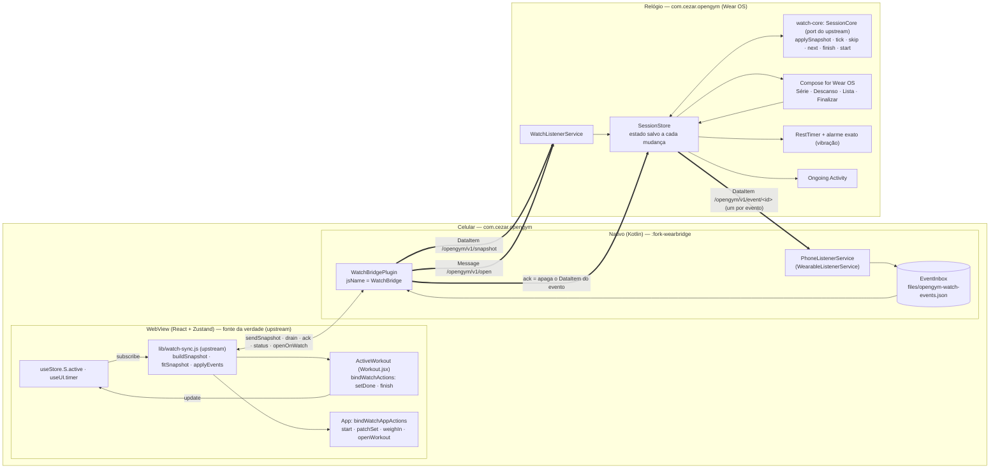
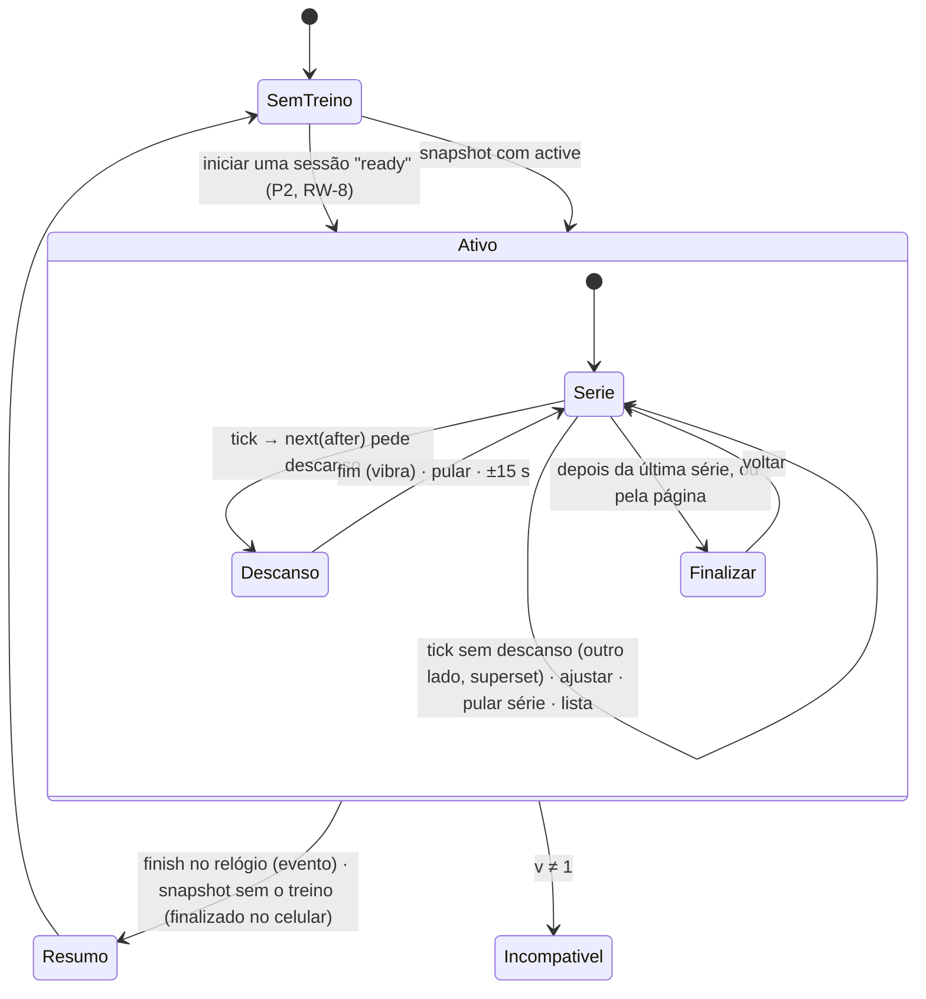

# Design — fork do openGym com APK próprio + app para Galaxy Watch

> Spec `fork-watch` · Fase 2 (Design) · **Revisão 2** · Requisitos: `requirements.md` (revisão 2)
> Status: R1 aprovada em 2026-10-13 · **R2 aprovada em 2026-10-14** (D-11: opção a)

Referências de requisito aparecem como `[RB-2.1]`, `[RS-2.1]` etc. Decisões aprovadas aparecem como `[D-n]`.

---

## 0. O que mudou na Revisão 2 (e por quê)

A R1 apostava que um *foreground service* manteria o JS da WebView rodando com o celular
bloqueado no bolso (alternativa A da antiga seção 6). **O spike M2.1 provou que não**
(resultados no `FORK.md`). No S25 Ultra com One UI 9, a WebView para de executar JS com menos de
1 minuto de tela apagada, mesmo com:
- FGS;
- renderer com prioridade fixa;
- wake lock na chegada da mensagem.

A parte nativa recebe cada mensagem na hora. Só que, com a tela apagada, o JS não roda, e em
alguns casos o evento nativo → JS se perdeu.

Na mesma investigação apareceu o branch `watch` do upstream, com 216 commits além da v1.4.1 e
ativo em 2026-10-14. Ele traz a ligação completa com o **Apple Watch**, feita para exatamente
esse cenário: *"the phone's page sleeps once the phone is locked in a pocket"*. O relógio conduz a
sessão sozinho. O celular guarda os eventos numa fila em arquivo e os aplica quando a página
acorda. A parte JS (`lib/watch-sync.js`) não depende de iOS: só a ponte nativa
(`WatchBridgePlugin.swift`) e o app do relógio são de Apple. O dono escolheu (2026-10-14)
**seguir o formato do upstream**.

| | R1 (aprovada) | R2 (esta) |
|---|---|---|
| Quem conduz o treino durante a série | O celular. O relógio manda comandos e espera o snapshot | **O relógio**, sozinho, a partir do snapshot. O celular aplica os eventos quando acorda |
| JS no celular | Nosso: `frontend/src/watch/` (snapshot, comandos, gancho no `Workout.jsx`) | **O do upstream:** `lib/watch-sync.js`, `lib/watch-settings.js` e `views/WatchSettings.jsx`, com 1 linha FORK para liberar o Android |
| Protocolo | Nosso v1 (9 comandos, `appliedThrough`) | **O do upstream** (snapshot `v:1` + eventos `start`, `setDone`, `finish`, `weighIn`, `setHr`, `watchStatus`) |
| Ponte nativa no celular | `WearBridge` + FGS durante o treino | **`WatchBridge` em Kotlin, com a mesma interface JS do plugin Swift.** Sem FGS |
| Lógica da sessão no relógio | Projeção otimista mínima | **Port para Kotlin do `WatchCore/SessionCore.swift` do upstream**, com os testes portados |
| Latência relógio → celular | ≤ 2 s com o celular bloqueado | **Imediata no relógio.** O celular aplica ao ser aberto (≤ 2 s com o app em primeiro plano) |
| ±15 s, pular descanso e navegar pelo relógio | Refletiam no celular | **Locais no relógio**, como no Apple Watch. O descanso e a posição do celular seguem os do celular |

**O que não muda:**
- o celular continua a fonte da verdade;
- as regras de treino (progressão, PRs, pré-preenchimento, avanço por toque) continuam só em JS e
  são aplicadas pelas próprias ações da tela de treino (`bindWatchActions`);
- os módulos e o build seguem a R1: `applicationId`, assinatura, versão, script de release e
  pareamento;
- a UI do relógio segue os mockups.

---

## 1. Resumo das decisões de arquitetura

| # | Decisão | Por quê |
|---|---|---|
| A-1 | **O JS do relógio é o do upstream.** O fork só libera o Android no `watchPlugin()` de `lib/watch-sync.js` (1 linha FORK) e adapta os rótulos "Apple Watch" na tela de configurações. | Zero regra de treino nova no fork [RW-1.2, RS-2.3]. Quando o upstream lançar a versão com relógio, o merge traz as melhorias sem conflito na lógica. |
| A-2 | **O relógio conduz a sessão sozinho; o celular aplica os eventos quando acorda.** | O spike M2.1 mostrou que o JS do celular não roda com a tela apagada (seção 6). O relógio não pode depender do celular durante a série. |
| A-3 | **Ponte nativa `WatchBridge` em Kotlin com a mesma interface do plugin Swift.** O transporte é a Data Layer: um `DataItem` para o snapshot e **um `DataItem` por evento**. | O JS do upstream chama `status`, `sendSnapshot`, `drain`, `ack` e `openOnWatch`, e não precisa saber se é iOS ou Android. Os `DataItem`s são duráveis e sincronizados pelo Google Play Services nos dois lados. Assim, a fila do relógio e a do celular sobrevivem a desconexão, reinício e app morto, sem reenvio feito à mão [RS-2.1, RO-1]. |
| A-4 | **O núcleo da sessão no relógio é um port de `WatchCore` (Swift) para Kotlin**, num módulo JVM puro (`:watch-core`) com os testes do upstream portados. | Mesmo comportamento do Apple Watch: o que vem depois de uma série, superset, lados, série pulada, conflito pelo `at` mais recente e fim no relógio ou no celular. Testável sem relógio. |
| A-5 | **Três módulos Gradle novos:** `:watch-core` (Kotlin/JVM), `:fork-wearbridge` (biblioteca Android do plugin) e `:wear` (app do relógio), ao lado do `:fork-health`, que já existe. | Isola o código novo e mantém o `app/` do upstream quase intocado [RB-9.2]. |
| A-6 | **Toda a configuração Gradle do fork num script aplicado por uma linha**, como na R1. | Merge simples [RB-9.3]. |
| A-7 | **D-11: como o JS do upstream entra no fork** (seção 14.1). | O branch `watch` do upstream ainda não foi lançado. É uma decisão do dono. |

---

## 2. Arquitetura

### 2.1 Visão geral



### 2.2 Fluxo de uma série concluída com o celular no bolso

```mermaid
sequenceDiagram
  autonumber
  participant U as Usuário
  participant W as Relógio (SessionStore + SessionCore)
  participant D as Data Layer (Play Services)
  participant L as PhoneListenerService
  participant I as EventInbox
  participant J as watch-sync.js (upstream)
  participant A as ActiveWorkout (upstream)
  U->>W: toca "Concluir" (carga e reps no bezel)
  W->>W: SessionCore.tick → série ✓, PendingTick, descanso local, vibra no fim
  W->>D: putDataItem /opengym/v1/event/<id> {type:setDone, wid, exId, entryIdx, setIdx, w, r, at}
  D->>L: onDataChanged (com o app do celular em segundo plano ou morto)
  L->>I: grava no arquivo (deduplica pelo id)
  L-->>J: "watchEvent" (só se a página estiver viva; com a tela apagada, fica parado)
  Note over J: … o usuário desbloqueia o celular / abre o app …
  J->>I: drain()
  J->>A: handlers.setDone(idx, i, {w, r, at}) — a mesma ação de um toque na tela
  J->>J: saveNow() — a mudança está no disco
  J->>I: ack([id]) → remove do arquivo e apaga o DataItem do evento
  J->>D: sendSnapshot (série feita, at ≥ tick)
  D->>W: snapshot → applySnapshot: o PendingTick sai, porque o snapshot já mostra a série feita
```

### 2.3 Componentes e responsabilidades

**Celular: JS (upstream, sem cópia).** `lib/watch-sync.js`, `lib/watch-settings.js`,
`views/WatchSettings.jsx` e os ganchos que o upstream já pôs no `Workout.jsx` e no `App`.
Mudanças FORK:

| Arquivo | Mudança |
|---|---|
| `lib/watch-sync.js` | `watchPlugin()`: `nativePlatform() !== 'ios'` → aceita também `'android'` (1 linha). `sendClips`/`dropClips` continuam sendo chamados, e o nativo Android responde sem fazer nada. |
| `views/Settings.jsx` | A rota de configurações do relógio, que no upstream só existe com `ios`, também aparece no Android (1–2 linhas). |
| `views/WatchSettings.jsx` | No Android, os textos "Apple Watch"/"Apple Health" viram "relógio (Wear OS)"/"Conexão Saúde" via `src/fork/strings.js`. Opções que o relógio Android não implementa (animação, calorias) ficam ocultas. Bloco FORK pequeno. |

**Celular: nativo (`frontend/android/fork-wearbridge/`, novo, Kotlin)**

| Classe | Responsabilidade |
|---|---|
| `WatchBridgePlugin` | Plugin Capacitor `WatchBridge`, com a mesma interface do Swift (seção 3.4). |
| `PhoneListenerService` | `WearableListenerService`. Em `onDataChanged` de `/opengym/v1/event/*`, grava o evento na `EventInbox` e avisa o plugin, se ele estiver vivo. Em `onCapabilityChanged`, emite `watchState`. Roda com o app morto, porque o Play Services o acorda. |
| `EventInbox` | Fila FIFO durável (`files/opengym-watch-events.json`, escrita atômica temp→rename). Deduplica por `id` e guarda o `DataItem` URI de cada evento para o `ack`. Limite de 1000 itens. |
| `SnapshotPublisher` | `putDataItem(PutDataMapRequest("/opengym/v1/snapshot").setUrgent())` com `{json, t}`. |

**Relógio (`frontend/android/watch-core/`, Kotlin/JVM, novo).** Port de
`ios/App/WatchCore/Sources/WatchCore/{Model,SessionCore}.swift`: `Snapshot`, `ActiveWorkout`,
`Entry`, `SetRow`, `Ready`, `WatchSettings`, `Event`, `SessionState`, `PendingTick` e as funções
puras `applySnapshot`, `tick`, `markSide`, `skip`, `next`, `setIndex`, `start`, `finish`,
`weighIn`, `progress` e `summary`. Os testes vêm de `SessionCoreTests.swift` e
`SetTypesTests.swift`, mais fixtures geradas pelo `buildSnapshot` do upstream (seção 12). As
funções de Apple Health (`healthToDelete`, `healthDeleted*`) ficam de fora.

**Relógio (`frontend/android/wear/`, novo, Kotlin + Compose for Wear OS)**

| Classe | Responsabilidade |
|---|---|
| `WatchListenerService` | Recebe o snapshot e a mensagem `/opengym/v1/open` mesmo com o app fechado. Aplica o snapshot no `SessionStore` e publica ou remove a Ongoing Activity [RW-6, RW-7, D-6]. |
| `SessionStore` | Equivalente ao `SessionStore.swift`. Guarda o `SessionState` em arquivo a cada mudança, chama o `SessionCore` e publica cada `Event` como `DataItem`. Remove o `PendingTick` quando o snapshot o confirma. Expõe `StateFlow` para a UI. |
| `EventSender` | `putDataItem("/opengym/v1/event/<id>")` com o JSON do evento. O Play Services entrega quando puder. Ao ver o item apagado pelo celular (`ack`), o evento está confirmado. |
| `RestTimer` | Descanso local, iniciado pelo `next(after:)` do core, com `restSec` da entrada ou o global do snapshot. Segue o `rest.endsAt` do snapshot quando o celular tiver um descanso rodando. ±15 s e pular são locais [RW-3]. Alarme exato para vibrar no fim [RW-3.3]. |
| `WatchWorkoutService` | FGS do relógio enquanto houver treino e o app tiver sido aberto. Hospeda a Ongoing Activity. No M5, vira o tipo `health` para a FC. |
| `ui/*` | Telas Compose (seção 8), seguindo os mockups aprovados. |

---

## 3. Contrato da sincronização (o do upstream, sobre a Data Layer)

### 3.1 Canais

| Canal | API | Direção | Conteúdo |
|---|---|---|---|
| `/opengym/v1/snapshot` | `DataClient` (`setUrgent`) | celular → relógio | DataMap `{json: String, t: Long}`. O `json` é exatamente a string que o `watch-sync.js` passa a `sendSnapshot` (`fitSnapshot(buildSnapshot(…))` + `settings`). A Data Layer guarda o último e entrega ao reconectar. |
| `/opengym/v1/event/<id>` | `DataClient` (`setUrgent`) | relógio → celular | DataMap `{json: String}` com um evento (3.3). Um item por evento. Fica até o celular apagar. |
| `/opengym/v1/open` | `MessageClient` | celular → relógio | Vazio. `openOnWatch()`: o relógio mostra a Ongoing Activity e vibra 1× [D-6]. Não abre a tela sozinho. |
| capability `opengym_phone` / `opengym_watch` | `CapabilityClient` | — | Em `res/values/wear.xml` de cada app. `status()` usa a do relógio. |

O limite de um `DataItem` é 100 KB, e o `fitSnapshot` do upstream já corta em 48 KB. Por isso,
o snapshot nunca passa do limite.

### 3.2 Snapshot (definido pelo upstream: `buildSnapshot` em `lib/watch-sync.js`)

```jsonc
{
  "v": 1, "unit": "kg", "restSec": 90,
  "ready": { "today": { "routineIds": […], "name": "Treino A", "entries": [ … ] }, "others": [ … ] },
  "active": {
    "id": "w_…", "name": "Treino A", "start": 1760390160000, "unit": "kg", "cur": 3, "restSec": 90,
    "rest": { "endsAt": 1760390555000 },          // descanso rodando no celular, ou null
    "entries": [{
      "id": "0576", "name": "Supino reto", "mode": "reps", "restSec": 120, "last": "60 kg × 8, …",
      "sets": [{ "w": 60, "r": 8, "sec": null, "done": false, "warmup": false, "at": 1760…,
                 "sides": { "L": {"w":…, "r":…, "done":…}, "R": {…} } }],
      "bodyweight": true, "perSide": true, "group": "a", "best": {"w":…, "r":…}, "assisted": true,
      "step": 2.5                                  // weightIncrement, igual ao stepper [D-7]
    }]
  },
  "settings": { "health": false, "restHaptics": true, "crown": "reps",
                "show": { "clip": true, "hr": true, "last": true, "elapsed": false, "kcal": false, "next": true, "rest": "ring" },
                "lang": "pt", "weighIn": true, "lastBw": 66.6 },
  "healthGone": [ … ]                              // Apple Health; o relógio Android ignora
}
```

Campos opcionais entram com o tempo, e um relógio antigo lê um celular novo. O `watch-core`
ignora campos desconhecidos. `v` diferente de 1 → "Atualize o app do relógio" [RS-1.5].

### 3.3 Eventos (relógio → celular), definidos pelo upstream (`applyEvents`)

| `type` | Campos | Efeito no celular (código do upstream) |
|---|---|---|
| `setDone` | `id, wid, exId, entryIdx, setIdx, w, r, sec?, side?, at, hr?` | Treino rodando: abre a tela do treino, se for preciso, e chama `handlers.setDone`: grava w/r e faz o mesmo `toggle` de um toque, com descanso, avanço e marca d'água. Treino já salvo: escreve no treino salvo. Conflito: o `at` mais recente vence. |
| `finish` | `id, wid, at` | `handlers.finish()`: o Finish e o salvar da própria tela. |
| `start` | `id, routineIds, wid, at, bw?` | Inicia aquela sessão com o id do relógio (P2 no fork, RW-8). |
| `weighIn` | `id, w, at` | Pesagem antes de um treino iniciado no relógio (P2). |
| `setHr` | `id, wid, exId, entryIdx, setIdx, hr?, restHr?` | FC numa série (M5). |
| `watchStatus` | `id, version, health` | Mostrado em Configurações → relógio. |

Todo evento tem `id` único (gerado no relógio). O celular aplica cada `id` uma vez (memória
`gym_watch_applied`, do upstream) e só faz `ack` depois de `saveNow()` [RS-3.1].

### 3.4 Interface `WatchBridge` (a mesma do Swift)

| Método / evento | Android |
|---|---|
| `status()` → `{supported, paired, installed, reachable, activated}` | `paired`: há nó conectado ou já visto. `installed`: algum nó tem a capability `opengym_watch`. `reachable`: nó conectado agora. `activated`: `true` depois da primeira consulta ao Play Services. |
| `sendSnapshot({json})` → `{sent}` | `putDataItem` urgente. `sent: true` quando o Play Services aceitou. A entrega ao relógio acontece quando ele estiver ao alcance. |
| `drain()` → `{events:[…]}` | Lê a `EventInbox` em ordem e, antes, varre os `DataItem`s `/opengym/v1/event/*` existentes, para pegar um evento que chegou com o listener fora do ar. |
| `ack({ids})` | Remove da inbox e apaga os `DataItem`s desses eventos. É a confirmação que o relógio vê. |
| `openOnWatch()` → `{ok}` | `MessageClient` `/opengym/v1/open` para os nós com `opengym_watch`. |
| `sendClips(…)`, `dropClips()` | Resolvem sem fazer nada: o relógio Android não mostra animações (fora de escopo). |
| evento `watchEvent` | Emitido quando um evento novo entra na inbox, com a página viva. |
| evento `watchState` | Emitido em `onCapabilityChanged` / `onPeerConnected`. |

---

## 4. Lado do celular em detalhe

### 4.1 Nada na lógica de treino
A tela de treino já tem `bindWatchActions` no upstream. O fork não adiciona gancho no
`Workout.jsx` e não exporta `doFinishWorkout`: os blocos FORK da R1 nesses arquivos deixam de
existir.

### 4.2 Sem foreground service
O spike mostrou que um FGS não mantém o JS rodando, e o `PhoneListenerService` é acordado pelo
Play Services mesmo com o app morto. Por isso, a R2 **não tem** o `WorkoutSessionService`. O único
FGS do celular continua sendo o `RestTimerService` do upstream, durante o descanso. Isso
economiza bateria e tira a notificação extra.

### 4.3 Quando o celular aplica
O `watch-sync.js` do upstream drena a fila:
- quando a página fica visível (`visibilitychange`);
- quando o store termina de carregar;
- quando chega `watchEvent` com a página viva;
- quando a tela de treino é montada.

Na prática: ao desbloquear o celular com o openGym em primeiro plano, a fila é aplicada na hora.
Com outro app na frente, a fila é aplicada ao voltar ao openGym.

### 4.4 Permissões e manifest (no `:fork-wearbridge`)
- `<service PhoneListenerService>` com `intent-filter` `DATA_CHANGED` (`/opengym/v1/event`) e
  `CAPABILITY_CHANGED`, `exported=true`, como exige a Data Layer.
- `res/values/wear.xml`: `android_wear_capabilities = [opengym_phone]`.
- Nenhuma permissão perigosa nova.

---

## 5. Lado do relógio em detalhe

### 5.1 Estados vistos pelo relógio



As regras de cada transição são as do `SessionCore` do upstream:
- **`next(after:)`:**
  - série por lado, com o outro lado por fazer → mesma entrada, sem descanso;
  - superset → próximo exercício do grupo, com descanso só depois do último da rodada;
  - senão → a próxima série não feita desta entrada e depois a próxima entrada que tem séries;
  - depois da última → Finalizar.
- **`applySnapshot`:**
  - adota o snapshot do celular;
  - mantém os `PendingTick` até um snapshot mostrar aquela série feita com `at` ≥ o do tick;
  - um treino finalizado no relógio não volta por um snapshot atrasado;
  - um treino iniciado no relógio não some por um snapshot que ainda não o conhece.
- **Conflito:** a mesma série mudada nos dois lados → o `at` mais recente vence, nos dois lados
  [RO-1.5].

Isso é ordem de exibição e de fila, não regra de treino: progressão, PRs e pré-preenchimento
continuam vindo do celular nos valores do snapshot [RW-1.2].

### 5.2 Ongoing Activity e serviço
- O snapshot com `active` (ou `/open`) faz o `WatchListenerService` publicar uma notificação
  ongoing com `OngoingActivity`. Ela tem o status do exercício atual ou "Descanso 0:45" (um
  `TimerPart`) e `touchIntent` para a tela do treino. Vibra uma vez [RW-6, RW-7, D-6].
- Abrir o app sobe o `WatchWorkoutService` (FGS), que assume a notificação.
- Fim do treino → remove tudo [RW-6.3].
- R-4: antes de o app ser aberto, só notificação comum (sem FGS).

### 5.3 Descanso e vibração
O `RestTimer` agenda `AlarmManager.setExactAndAllowWhileIdle` para o fim, com um receiver que
vibra (300-150-300 ms) se `settings.restHaptics`. Permissão `USE_EXACT_ALARM`, com
`SCHEDULE_EXACT_ALARM` de reserva. O alarme é reagendado a cada mudança e cancelado ao pular
[RW-3.3].

---

## 6. Risco crítico: WebView suspensa (resolvido pelo spike)

| | A. FGS durante o treino (R1) | **B. Relógio autônomo + fila durável (R2)** | C. Lógica em Kotlin | D. Motor JS headless |
|---|---|---|---|---|
| Funciona com o celular bloqueado? | ❌ **Medido no M2.1: o JS para em < 1 min** | ✅ O relógio não depende do celular | ✅ | ⚠️ não testado, frágil |
| Regras em um lugar só | ✅ | ✅ (JS do upstream) | ❌ proibido | ⚠️ |
| Perde eventos | ⚠️ (evento nativo → JS perdido no spike) | ✅ não: `DataItem` + arquivo | — | — |
| Bateria do celular | FGS o treino inteiro | Mínima: só o listener acordado por evento | — | Alta |
| Conflito com o upstream | Alto (gancho próprio no `Workout.jsx`) | **Mínimo: é o desenho do upstream** | Alto | Alto |

**Escolha: B**, no formato do upstream. O custo é que o celular só reflete o relógio quando é
aberto. Para quem está com o celular no bolso, isso não aparece, porque tudo de que a série
precisa está no relógio.

---

## 7. Offline e reconexão

Para o relógio, offline é o normal: ele já conduz tudo sozinho.
- **Eventos:** cada um é um `DataItem` local no relógio. O Play Services sincroniza em ordem
  quando houver Bluetooth ou Wi-Fi. Os eventos sobrevivem a reinício do relógio, app fechado e
  modo avião [RO-1.1, RO-1.4, RO-1.6].
- **Estado da sessão:** o `SessionStore` salva o `SessionState` em arquivo a cada mudança e
  restaura ao abrir. Depois, aplica o último snapshot por cima, mantendo os ticks pendentes.
- **Indicador:** sem nó conectado, a página Série mostra "sem conexão". Isso é informativo: nada
  fica bloqueado [RO-1.2].
- **Treino finalizado ou descartado no celular enquanto o relógio estava longe:** o snapshot sem
  o treino encerra a sessão no relógio. Os ticks feitos nesse meio-tempo ainda vão, e o celular os
  grava no treino salvo (`patchSet` do upstream), sem tocar em outro treino [RO-1.7].

---

## 8. UI do relógio

Segue os mockups aprovados (https://claude.ai/artifact/PdkUEd57Dc2Qg4orNayZEe). Mudanças da R2:
- **Descanso:** −15 s / Pular / +15 s mudam só o descanso do relógio. A página mostra a próxima
  série que o `next(after:)` escolheu.
- **Lista:** tocar num exercício muda o exercício do relógio. O celular segue com o dele.
- **Série:** o bezel ajusta o campo em foco: carga em ± `step` [D-7], reps em ± 1 (mínimo 0).
  `settings.crown` define o campo inicial. Os valores ajustados vão no `setDone` (`w`, `r`), não
  como comandos separados. "Pular série" (`skip`) existe como no upstream: a série fica não feita
  e a próxima aparece.
- **Tipos de série [D-5]:**
  - reps+carga, por lado e aquecimento: completos;
  - tempo (`sec`): mostra o tempo planejado e conclui com ele;
  - cardio: conclui sem números;
  - drop set e rest-pause: concluem a série principal; o detalhe se edita no celular.
- **Finalizar:** segurar 1,5 s → evento `finish` e a tela de resumo do `summary()` (duração,
  séries, PRs pelo `best`). Sem "Descartar" [RW-5.3].
- **Textos:** inglês + pt-BR, reaproveitando as traduções de
  `ios/App/Watch/pt-BR.lproj/Localizable.strings` do upstream onde couberem. O idioma segue
  `settings.lang` (o do app), como no Apple Watch.

### 8.1 Bezel giratório
`Modifier.onRotaryScrollEvent` na página Série. Acumula pixels e aplica um passo por limiar, com
haptic por passo. Na Lista, o bezel rola a lista.

### 8.2 Modo ambiente
`AmbientLifecycleObserver`: fundo preto, texto fino, sem botões nem animação, só "exercício ·
série X/Y · carga × reps" ou o descanso. Atualiza ≈ 1/min, com deslocamento anti burn-in
[RE-1.1].

---

## 9. Build, assinatura e versionamento

Como na R1 (já em uso desde o M1), com os módulos novos:

```
frontend/android/
├─ settings.gradle            ← FORK: 1 linha apply from: '../../fork/android/fork-settings.gradle' (já existe)
├─ build.gradle               ← FORK: classpath Kotlin + compose compiler + serialization (M2)
├─ app/build.gradle           ← FORK: 1 linha no fim apply from: fork-app.gradle (já existe)
├─ app/src/main/java/.../MainActivity.java  ← FORK: registerPlugin(WatchBridgePlugin.class)
├─ fork-health/               (existe) leitura do Health Connect
├─ watch-core/                (novo) Kotlin/JVM + kotlinx-serialization — port do WatchCore + testes
├─ fork-wearbridge/           (novo) Android library — WatchBridgePlugin, listener, inbox
└─ wear/                      (novo) Android app — Compose for Wear OS, depende de :watch-core
```

- **Versões:** AGP e Gradle seguem os do upstream. Kotlin 2.0.21 (ou o compatível com o AGP que
  vier com o D-11), compose compiler da mesma versão, kotlinx-serialization 1.7.x. As bibliotecas
  Wear são fixadas no M2.
- **Assinatura e versão:** iguais à R1 (`fork-signing.gradle`, `fork-version.gradle`;
  `versionCode = upstream × 1000 + forkBuild`) [RB-2, RB-3]. Celular e relógio têm o mesmo
  `applicationId`, a mesma chave e o mesmo `versionCode` [RS-1.6].
- **Script de release:** como na R1, mais `:wear:assembleRelease`, a comparação de certificados e
  pacote, e `--install` no relógio por Wi-Fi [RB-6]. Se o upstream (D-11) trouxer *flavors*
  (`sideload`/`play`), o fork usa o `sideload`.

---

## 10. Arquivos existentes tocados (todos com `// FORK:`)

| Arquivo | Mudança | Linhas |
|---|---|---|
| (R1, já feitos) `settings.gradle`, `app/build.gradle`, `lib/update.js`, `.gitignore`, `lib/import-csv.js`, `lib/health-sync.js`, `MainActivity.java` (fork-health), `main.jsx` (fork-health), `views/Settings.jsx` (fork-health) | ver `FORK.md` | — |
| `frontend/android/build.gradle` | classpath Kotlin, compose e serialization | 3 |
| `MainActivity.java` | `registerPlugin(WatchBridgePlugin.class)` | 1 |
| `frontend/src/lib/watch-sync.js` (upstream, D-11) | `watchPlugin()` aceita `android` | 1 |
| `frontend/src/views/Settings.jsx` | página de configurações do relógio também no Android | 1–2 |
| `frontend/src/views/WatchSettings.jsx` (upstream, D-11) | rótulos Android + ocultar opções sem suporte | ~6 |

**Saem da R1:** o gancho no `Workout.jsx`, o `export` no `sheets.jsx` e
`frontend/src/watch/**`.

**Não muda:** `frontend/src/lib/**` (lógica de treino), exceto a linha de plataforma acima,
`RestTimerService`/`RestAlert*`, `api/`, `web/`, `helm/`, `kubernetes/`, Docker, CI, `LICENSE`,
`NOTICE.md` e a mídia [RB-9.1].

---

## 11. Itens P2 (M5)

### 11.1 Frequência cardíaca [RP2-1, D-4]
O upstream já define o caminho: `setHr`/`hr` no `setDone`, `lib/heart-rate.js` (`sanitizeHr`) e
`hr`/`restHr` gravados na série. No relógio, o Health Services (`ExerciseClient`,
`STRENGTH_TRAINING`, `HEART_RATE_BPM`) roda durante o treino com o app aberto (FGS `health`),
com `BODY_SENSORS` e `ACTIVITY_RECOGNITION` pedidas na primeira vez. Como o campo é do próprio
upstream, o portão de compatibilidade do D-4 vira conferir que o backup com `hr` importa no app
oficial *da versão que tiver o relógio*.

### 11.2 Live Update / Now Bar [RP2-2, D-2]
Sem o FGS da R1, não há notificação de treino no celular para promover. Opções para o M5:
(a) usar a notificação de descanso do upstream; (b) uma notificação própria só quando o celular
estiver aberto. A escolha fica para o M5.

---

## 12. Estratégia de testes

| Camada | O quê | Ferramenta | Requisitos |
|---|---|---|---|
| JS (upstream) | `watch-sync.test.js`, `watch-sync.*.test.js`, `watch-settings.test.js`, `Workout.watch.test.jsx`, `Settings.watch.test.jsx`: vêm com o D-11 e continuam passando | vitest | RW-1..5, RS-3 |
| JS (fork) | `src/fork/watch-android.test.js`: com `nativePlatform()='android'`, o `watchPlugin` existe, o snapshot sai e os eventos drenam com ack, com um plugin falso | vitest | RS-1.4 |
| JS → Kotlin | fixtures: um teste vitest grava `buildSnapshot` de treinos reais (Treino A, superset, por lado, tempo, cardio, aquecimento) em `watch-core/src/test/resources/fixtures/*.json`, e o `:watch-core:test` lê sem erro | vitest + JUnit | RS-1.5, RT-2 |
| Kotlin core | port de `SessionCoreTests.swift` e `SetTypesTests.swift`, caso a caso | JUnit (`:watch-core:test`) | RO-1.5, RW-1..5 |
| Kotlin celular | `EventInbox`: ordem, dedupe, persistência, recuperação recriando a instância, `ack` | JUnit | RS-2.1, RS-3.1 |
| Kotlin relógio | `SessionStore` (salva e restaura, pendentes), `RestTimer` com relógio falso | JUnit | RO-1.6, RW-3 |
| Emulador | emulador de celular + Wear pareados: telas, bezel, ambiente | Android Studio | RT-5 |
| Aparelho real | checklist por marco | S25 Ultra + Galaxy Watch 4 Classic | RT-4 |

**Checklist manual base:**
1. Upgrade N → N+1 dos dois sem perda [RB-7].
2. Iniciar o Treino A no celular → Ongoing Activity e 1 vibração no relógio.
3. Celular bloqueado no bolso: 3 séries no relógio com ajuste de carga pelo bezel; o descanso
   vibra no fim de cada uma → desbloquear o celular: as 3 séries aparecem com as cargas do
   relógio, sem duplicar [RS-1.1, RS-2.1].
4. Superset (montar um par na rotina): o relógio alterna os exercícios e descansa só no fim da
   rodada.
5. Modo avião no relógio: concluir 2 séries → tirar o modo avião → aparecem no celular [RO-1].
6. Finalizar pelo relógio (segurar) → resumo no relógio; ao abrir o celular, o treino está no
   histórico com PRs.
7. Matar o app do celular (recentes) antes de tocar no relógio → ao reabrir, as séries estão lá.
8. Bateria do relógio antes e depois de 60 min [RE-1.5].

---

## 13. Riscos e mitigação

| # | Risco | Prob. | Mitigação |
|---|---|---|---|
| R-1 | JS da WebView não roda em segundo plano | **Ocorreu** (M2.1) | R2: o relógio é autônomo e a fila é durável. |
| R-2 | Samsung mata o processo do celular | Média | Sem efeito na R2: os eventos são `DataItem`s e o listener é acordado pelo Play Services. O guia "Sem restrições" fica como recomendação. |
| R-3 | O branch `watch` do upstream mudar o protocolo antes de ser lançado | **Alta** | O `watch-core` lê campos opcionais e ignora desconhecidos. As fixtures são regeneradas do `buildSnapshot` real a cada merge e quebram o teste Kotlin se algo mudar. O plano de merge (14) roda esses testes primeiro. |
| R-4 | FGS no relógio iniciado em segundo plano é bloqueado | Média | Antes de abrir o app, só notificação comum. O alarme exato garante a vibração. |
| R-5 | Bibliotecas Wear exigirem `compileSdk`/AGP mais novos | Baixa | Fixar a versão anterior. O upstream pode subir o AGP (D-11), o que ajuda. |
| R-6 | APK do celular grande | Baixa | Celular por USB. O relógio não leva mídia (alvo < 15 MB). |
| R-7 | CPU do PC sem a instrução das command-line tools novas | Ocorreu | Tools 15859902 fixadas (`FORK.md`). |
| R-8 | Código não lançado do upstream no celular do dia a dia (D-11 a) | Média | Backup exportado antes de cada instalação, a suíte completa no script de release e o upgrade N → N+1 no checklist. Voltar para a v1.4.1 não é garantido (`adb install -r` não aceita versionCode menor, e o formato de dados pode ter mudado): o caminho de volta é desinstalar, instalar o APK anterior e restaurar o backup. |
| R-9 | Relógio do celular e do relógio com horários diferentes | Baixa | O `at` dos eventos usa o relógio do relógio, como no upstream. A Data Layer sincroniza os horários pelo celular. |

---

## 14. Plano de merge com o upstream

### 14.1 D-11 — como o JS do relógio entra no fork (decisão do dono)

| | (a) **Seguir o branch `watch` do upstream agora** | (b) Branch de integração até o lançamento |
|---|---|---|
| O quê | `git merge upstream/watch` no `fork/main`. O fork acompanha esse branch até ele entrar no `upstream/main`. Depois, volta a seguir as tags. | `fork/watch-next` = `fork/main` + `upstream/watch`. O desenvolvimento e os testes do relógio acontecem nele. O `fork/main` (o app do dia a dia) fica na v1.4.1 até o upstream lançar. |
| Relógio no dia a dia | Assim que o M3 terminar | Só depois de o upstream lançar a versão com relógio, ou instalando o `fork/watch-next` |
| Risco | Código ainda não lançado no celular (R-8) | Dois branches para manter. O app do dia a dia não ganha o relógio antes do lançamento |
| Conflitos medidos | 5 arquivos, todos pontos FORK: `health-sync.js`/`.test.js`, `Settings.jsx`, `MainActivity.java`, `settings.gradle` | Os mesmos, resolvidos no `fork/watch-next` |

Recomendação: **(a)**. O treino acontece no relógio, e esperar o lançamento deixaria o app do
relógio sem uso por tempo indefinido. O risco é controlado com backup, testes e upgrade
conferido. **Decisão do dono (2026-10-14): (a).**

### 14.2 Rotina de merge
1. `git fetch upstream`. `git merge` (nunca rebase) do branch escolhido no D-11 ou da tag nova.
2. Conflitos só nos pontos `// FORK:` (`git grep -n "FORK:"` e a tabela do `FORK.md`).
3. Antes de compilar: `npm test` (com os testes de relógio do upstream e do fork), regenerar as
   fixtures e rodar `:watch-core:test` (R-3).
4. `scripts/fork-release.sh --install` e o checklist curto (itens 1, 2, 3 e 6).
5. O fork nunca faz push para `upstream` e nunca abre PR ou issue no repositório original.

---

## 15. Rastreabilidade

| Requisito | Seções |
|---|---|
| RB-1..9 | 9, 10, 14 |
| RW-1 | 3.2, 5.1, 8 |
| RW-2 | 8, 8.1 |
| RW-3 | 5.1, 5.3, 8 |
| RW-4 | 5.1, 8 |
| RW-5 | 3.3, 8 |
| RW-6 / RW-7 | 3.1 (`/open`), 5.2 |
| RW-8 (P2) | 3.3 (`start`, `weighIn`), 5.1 |
| RS-1 | 0, 2.2, 3, 4.3 |
| RS-2 | 6, 2.2 |
| RS-3 | 3.3 |
| RO-1 | 5.1, 7 |
| RE-1 | 4.2, 8.2 |
| RP2-1 / RP2-2 | 11 |
| RT-1..5 | 12 |
