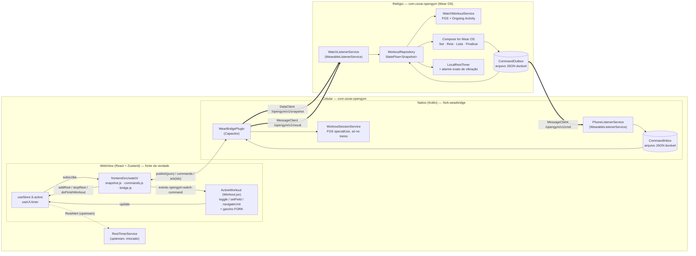
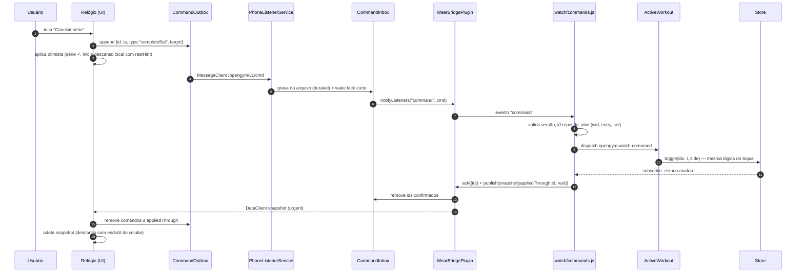
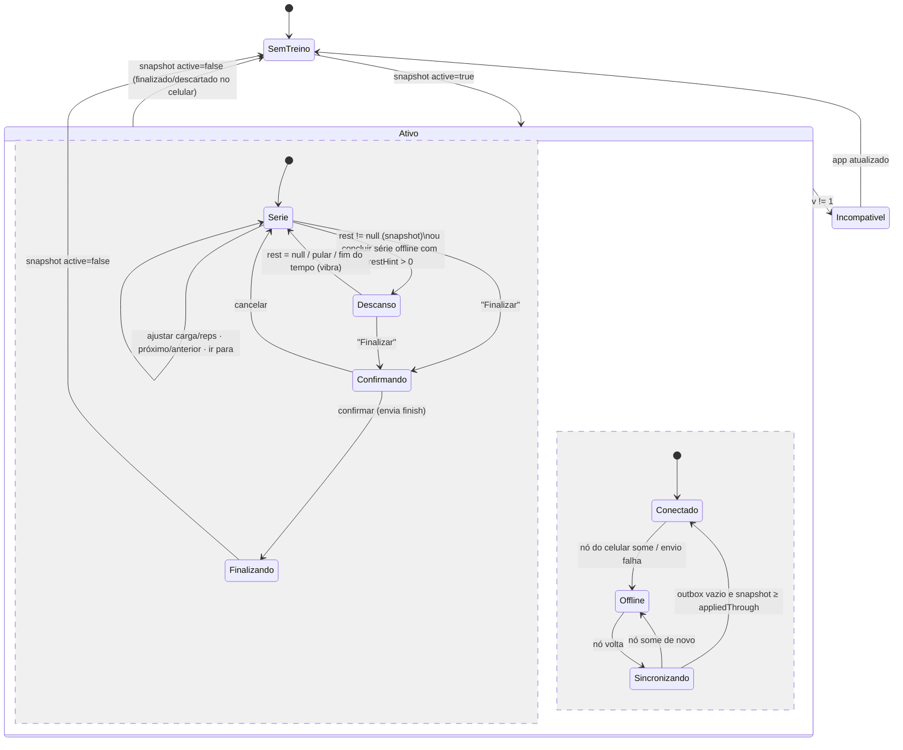
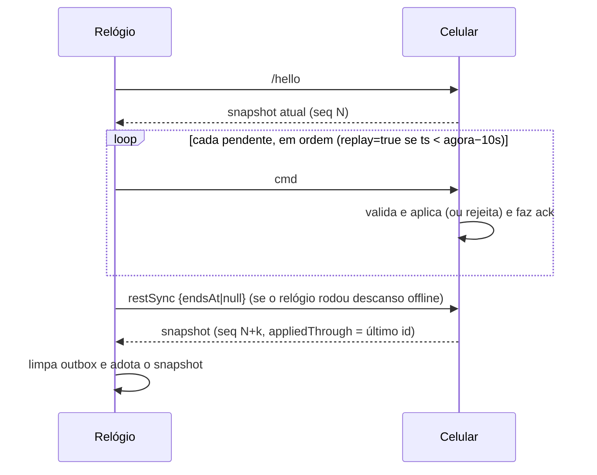

# Design — fork do openGym com APK próprio + app para Galaxy Watch

> Spec `fork-watch` · Fase 2 (Design) · Base: upstream v1.4.1 · Requisitos: `requirements.md` (aprovado)
> Status: **aprovado em 2026-10-13**

Referências de requisito aparecem como `[RB-2.1]`, `[RS-2.1]` etc. Decisões aprovadas aparecem como `[D-n]`.

---

## 1. Resumo das decisões de arquitetura

| # | Decisão | Por quê |
|---|---|---|
| A-1 | **O celular executa os comandos do relógio pelas mesmas funções da tela** (`toggle`, `setField`, `navigateUnit` do `ActiveWorkout`), por um gancho mínimo no `Workout.jsx`. | Essa lógica não é pura: depende de estado do componente (`progressHighWater`, modo lista, superset). Copiá-la para outro módulo faria as regras divergirem a cada release do upstream. Chamá-la pelo mesmo caminho do teclado (`onKey`, que já existe) garante comportamento idêntico a um toque na tela [RW-1.2, RS-2.3]. |
| A-2 | **Foreground service no celular durante todo o treino ativo + fila durável no nativo + timer autônomo no relógio.** | Resolve a WebView suspensa com latência < 2 s [RS-1.1] e sem perder comandos se o processo morrer [RS-2.1]. Comparação na seção 6. |
| A-3 | **O snapshot é montado no JS por função pura** (`buildSnapshot`) e só publicado quando muda. | O relógio mostra apenas dados prontos (carga, reps, passo do bezel, descanso), sem regra de treino [RW-1.2, RE-1.4]. |
| A-4 | **Três módulos Gradle novos**: `:fork-protocol` (Kotlin/JVM puro), `:fork-wearbridge` (biblioteca Android do plugin Capacitor) e `:wear` (app do relógio). | Isola o código novo, dá a cada módulo o próprio manifest e mantém o `app/` do upstream quase intocado [RB-9.2]. |
| A-5 | **Toda a configuração do fork no Gradle fica num script aplicado por uma linha** (`fork/android/fork-app.gradle`). | `applicationId`, nome, assinatura, versão e dependências ficam fora do `build.gradle` do upstream. O merge vira uma linha [RB-9.3]. |
| A-6 | **Protocolo JSON versionado** (`v: 1`) sobre a Data Layer: `DataClient` para o snapshot e `MessageClient` para comandos, com id único e confirmação por "último id aplicado". | Simples de testar nos dois lados, idempotente e com detecção de versão incompatível [RS-1.3, RS-1.5, RS-3.1]. |

---

## 2. Arquitetura

### 2.1 Visão geral



### 2.2 Fluxo de um comando (concluir série com o celular no bolso)



### 2.3 Componentes e responsabilidades

**Celular — JS (`frontend/src/watch/`, novo)**

| Arquivo | Responsabilidade |
|---|---|
| `index.js` | `startWatchBridge(useStore, useUI)`. Só roda em `MOBILE` no Android. Assina os stores, escuta o plugin e liga e desliga a sessão nativa quando `S.active` aparece ou some. |
| `snapshot.js` | `buildSnapshot(S, timer, meta)` → objeto do protocolo (seção 3.2). Função pura e testada. Reusa `supersetUnits`, `setNumberAt`, `nextOpenSet`, `weightIncrement`, `modeOf`, `restSecFor`, `warmupRestSecFor`, `pyramidRestFor` e o nome localizado do exercício. Nenhuma regra nova. |
| `commands.js` | `validateCommand(cmd, S, applied)` (pura, testada) e `applyCommand(cmd)`. Comandos de série e navegação viram o evento `opengym:watch-command` para o `ActiveWorkout`. Descanso e finalizar são executados direto no store. |
| `applied.js` | Memória dos últimos 200 ids aplicados (persistida em `localStorage` `gym_watch_applied`) para deduplicar [RS-3.1]. |
| `bridge.js` | `registerPlugin('WearBridge')` e um stub silencioso fora do Android. |
| `*.test.js` | vitest, no padrão do upstream [RT-1]. |

**Celular — nativo (`frontend/android/fork-wearbridge/`, novo, Kotlin)**

| Classe | Responsabilidade |
|---|---|
| `WearBridgePlugin` | Plugin Capacitor `WearBridge`. Métodos: `startSession()`, `stopSession()`, `publish({json})`, `ack({ids})`, `pending()` (devolve a fila ao JS na inicialização) e `status()` (nós conectados). Evento: `command`. |
| `PhoneListenerService` | `WearableListenerService` filtrado por `/opengym/v1/cmd`. Grava na `CommandInbox`, segura um wake lock de 5 s e avisa o plugin se ele estiver vivo. Também atende `/opengym/v1/hello` (o relógio pede o snapshot atual). |
| `CommandInbox` | Fila FIFO durável (`files/opengym-watch-inbox.json`, escrita atômica temp→rename como o upstream). Ignora ids repetidos. Limite de 500 itens. |
| `WorkoutSessionService` | FGS `specialUse` ligado do início ao fim do treino. Notificação silenciosa e de baixa importância ("Treino em andamento · <exercício>"). Mantém o processo fora do *cached apps freezer*. Não segura wake lock contínuo. |
| `SnapshotPublisher` | `putDataItem(PutDataMapRequest("/opengym/v1/snapshot").setUrgent())` com o JSON e um `seq`. Na ausência de treino, publica `{active:false}`. |

**Relógio (`frontend/android/wear/`, novo, Kotlin + Compose for Wear OS)**

| Classe | Responsabilidade |
|---|---|
| `WatchListenerService` | Recebe mudanças em `/opengym/v1/snapshot` e mensagens `/opengym/v1/result` mesmo com o app fechado. Atualiza o `WorkoutRepository` e publica ou remove a Ongoing Activity. |
| `WorkoutRepository` | `StateFlow<WatchState>` = snapshot do celular + comandos pendentes aplicados por cima (otimista). Única fonte para a UI. |
| `CommandOutbox` | Fila durável (`files/outbox.json`). Envia em ordem para o nó do celular (`CapabilityClient`, capability `opengym_phone`) e reenvia ao reconectar. Remove itens quando chegam ao `appliedThrough`. |
| `OptimisticReducer` | Projeção dos pendentes sobre o snapshot **apenas para exibição**: marca a série ✓, troca o valor de carga ou reps, move o cursor dentro da lista que veio pronta e inicia o descanso local com o `restHint` recebido. Não decide progressão nem superset. |
| `LocalRestTimer` | Timer do descanso enquanto offline, ou enquanto o snapshot não chega. Agenda um alarme exato para vibrar no fim [RW-3.3, RO-1.3]. |
| `WatchWorkoutService` | FGS do relógio enquanto houver treino e o app tiver sido aberto. Hospeda a Ongoing Activity [RW-6]. |
| `ui/*` | Telas Compose (seção 8). |

---

## 3. Contrato da sincronização (protocolo v1)

### 3.1 Canais

| Canal | API | Direção | Conteúdo |
|---|---|---|---|
| `/opengym/v1/snapshot` | `DataClient` (DataItem, `setUrgent()`) | celular → relógio | DataMap `{ json: String, seq: Long }`. A Data Layer entrega só o último estado e o guarda para quando o relógio reconectar. |
| `/opengym/v1/cmd` | `MessageClient` | relógio → celular | Bytes UTF-8 de um JSON `Command`. |
| `/opengym/v1/result` | `MessageClient` | celular → relógio | Bytes UTF-8 `{v, id, ok:false, reason}`. Só enviado para comando rejeitado. |
| `/opengym/v1/hello` | `MessageClient` | relógio → celular | `{v, watchVersion}`. O celular republica o snapshot (útil depois de reinstalar o relógio). |
| Capability `opengym_phone` / `opengym_watch` | `CapabilityClient` | — | Declaradas em `res/values/wear.xml` de cada app, para achar o nó certo. |

Versão: todo payload tem `v`. **Regra:** `v` diferente de 1 é ignorado, e a UI do lado que recebeu mostra "Atualize o app do relógio/celular" [RS-1.5]. Campos novos opcionais podem entrar sem mudar `v`. Remover ou mudar o sentido de um campo exige `v: 2`.

### 3.2 Snapshot (`buildSnapshot`)

```jsonc
{
  "v": 1,
  "active": true,                 // false: sem treino, ou editando/backfill de treino salvo
  "seq": 1842,                    // contador monotônico do celular (por instalação)
  "wid": "w_m4x9…",               // S.active.id — identidade do treino
  "name": "A – Peito, Ombros e Tríceps",
  "startedAt": 1760390160000,
  "unit": "kg",
  "cur": 3,                       // índice da entrada atual (S.active.cur, já limitado)
  "units": [[0],[1],[2,3],[4]],   // supersetUnits(entries) — para navegar offline sem regra
  "focus": { "entry": 3, "set": 1, "side": null },   // nextOpenSet(entries, cur) ou null
  "entries": [
    {
      "idx": 3,
      "exId": "bench_press_dumbbell",
      "name": "Supino com halteres",           // nome localizado, igual ao da tela
      "sg": "a",                               // grupo de superset ou null
      "mode": "reps",                          // reps | time | cardio
      "perSide": false,
      "wStep": 2.5,                            // weightIncrement(cfg, unit) [D-7]
      "restHint": 90,                          // descanso se a próxima série aberta for concluída (offline)
      "doneSets": 1, "totalSets": 4,           // setsDone/setUnits da entrada
      "editable": true,                        // false → relógio mostra "editar no celular" [D-5]
      "sets": [
        { "i": 0, "label": "A1", "warm": true,  "w": 20, "r": 12, "done": true },
        { "i": 1, "label": "1",  "warm": false, "w": 32, "r": 10, "done": false },
        { "i": 2, "label": "2",  "w": 32, "r": 10, "done": false, "type": "dropset" },
        { "i": 3, "label": "3",  "w": 32, "r": 10, "done": false,
          "sides": { "L": { "w": 16, "r": 10, "done": false }, "R": { "w": 16, "r": 10, "done": false } } }
      ]
    }
  ],
  "rest": { "endsAt": 1760390555000, "totalSec": 90, "paused": false, "leftSec": null, "entry": 3, "kind": null },
  "appliedThrough": "c_01HF…",    // id do último comando do relógio aplicado (ou null)
  "ts": 1760390465123             // relógio do celular quando o snapshot foi montado
}
```

Regras:
- Séries de tempo levam `sec`. Cardio leva `min`/`speed`. Campos ausentes significam "não se aplica".
- O tamanho fica dentro do limite de 100 KB do DataItem. Um treino de 12 exercícios × 6 séries fica perto de 15 KB. Se passar de 90 KB, o snapshot leva só a entrada atual completa e as outras resumidas (`sets: []`, com `doneSets` e `totalSets`).
- **Diferença de relógio**: o relógio calcula `offset = snapshot.ts − agora` na chegada e usa `endsAt − offset` para o countdown. Assim celular e relógio terminam o descanso com diferença ≤ 1 s [RW-3.2].
- Publicação: `subscribe` nos dois stores → `buildSnapshot` → compara o JSON sem `ts`/`seq` com o último publicado → publica com debounce de 150 ms. Sem mudança, nada é enviado [RE-1.4]. Não há heartbeat: a Data Layer já guarda o último item.

### 3.3 Comandos (`Command`)

Envelope comum:

```jsonc
{ "v": 1, "id": "c_<ULID>", "ts": 1760390470000, "type": "completeSet",
  "wid": "w_m4x9…", "baseSeq": 1842, "replay": false, "args": { … } }
```

- `id`: ULID gerado no relógio, ordenável e único [RS-3.1].
- `wid`: o treino em que o comando foi gerado. Se `wid` for diferente de `S.active.id`, é rejeitado com `workout-ended` [RO-1.7].
- `baseSeq`: o `seq` do snapshot que o relógio via. Serve para diagnóstico e para detectar edição concorrente (seção 7).
- `replay`: `true` quando o comando foi gerado offline e está sendo reenviado depois de mais de 10 s.

**Alvo de série** (`target`, usado por vários comandos): `{ "entry": 3, "exId": "bench_press_dumbbell", "set": 1, "side": null }`. O celular confere `entries[entry].id === exId`. Se não bater (a lista mudou), procura a única entrada com esse `exId`. Se houver zero ou mais de uma, rejeita com `target-moved` [RS-3.2]. Também rejeita se `set` estiver fora do intervalo.

| `type` | `args` | Efeito no celular | Implementação |
|---|---|---|---|
| `completeSet` | `{ target }` | Marca a série (ou o lado) como feita, **só se ainda não estiver feita** (não é toggle, para ser idempotente). Dispara descanso e avanço pela lógica do `toggle`. | evento → `ActiveWorkout.toggle(idx, i, side)` |
| `setWeight` | `{ target, w }` | Valor absoluto. Aplica cascata e `weightOrigin` como na tela. | evento → `setField(idx, i, 'w', w)` (`sides.*.w` usa o caminho de lado já existente) |
| `setReps` | `{ target, r }` | Valor absoluto, mínimo 0. | evento → `setField(idx, i, 'r', r)` |
| `goTo` | `{ entry, exId }` | Troca o exercício atual. | evento → `selectFocusEntry(idx)` |
| `nav` | `{ dir: 1 \| -1 }` | Próximo/anterior por unidade de superset. | evento → `navigateUnit(dir)` |
| `restAdjust` | `{ deltaSec: 15 \| -15 }` | ±15 s no descanso que estiver rodando. | `useUI.getState().addRest(deltaSec)` |
| `restSkip` | `{}` | Pula o descanso. | `useUI.getState().stopRest()` |
| `restSync` | `{ endsAt \| null, totalSec }` | Só no fim de um replay: alinha o descanso do celular ao que o relógio rodou offline (seção 7). | `startRest(restante)` ou `stopRest()` |
| `finish` | `{}` | Grava o treino (o relógio já pediu confirmação). | `doFinishWorkout()` (passa a ser exportado, `// FORK:`) |

Comandos de série e navegação usam valores absolutos ou "fazer se ainda não feito". Por isso, reaplicar um comando é seguro mesmo se a deduplicação falhar.

**Resultado:** comando aplicado aparece em `appliedThrough` do próximo snapshot. Comando rejeitado gera `/opengym/v1/result` com `reason` ∈ `workout-ended | target-moved | out-of-range | no-workout | bad-version | not-editable`, e o relógio mostra um toast curto ("Série não encontrada — confira no celular"). Comandos rejeitados também avançam o `appliedThrough`, para o relógio limpar a fila.

### 3.4 Ordem e entrega

- O relógio envia um comando por vez, em ordem, e só envia o próximo depois de o `sendMessage` resolver. A fila do celular preserva a ordem de chegada.
- `MessageClient` não garante entrega. Se o envio falhar, o comando continua no outbox e é reenviado ao reconectar ou a cada 5 s enquanto houver nó. O `id` evita aplicação dupla.
- O celular processa a inbox em ordem FIFO, um comando por vez, e só dá `ack` depois de o store refletir a mudança.

---

## 4. Lado do celular em detalhe

### 4.1 Gancho no `ActiveWorkout` (única mudança na lógica da tela)

No `Workout.jsx`, ao lado do `onKey` que já existe, entra um `watchCommand.current = cmd => …` e um `useEffect` que escuta `opengym:watch-command`. Fica em ~30 linhas entre marcadores `// FORK: watch bridge — begin/end`. Ele:

1. resolve `idx`/`i` (o `commands.js` já validou);
2. `completeSet`: se a série ou o lado já estiver `done`, não faz nada. Se for série de tempo sem lado, marca como feita com o `sec` planejado em vez de iniciar o hold [D-5]. Senão, chama `toggle(idx, i, side)`;
3. `setWeight`/`setReps` → `setField`. `goTo` → `selectFocusEntry`. `nav` → `navigateUnit`;
4. dispara `opengym:watch-command-done` com `{id}` para o `commands.js` confirmar.

O `ActiveWorkout` só existe na rota `/workout`. Se chegar comando de série com o app em outra tela, o `commands.js` faz `location.hash = '#/workout'` e guarda o comando até o gancho anunciar que está pronto (evento `opengym:watch-ready`, com timeout de 3 s → `ack` com `not-editable`).

Descanso (`addRest`, `stopRest`) e `finish` não precisam da tela: já são funções do store (`useUI`) ou de módulo (`doFinishWorkout`).

### 4.2 Sessão nativa

- `S.active` passa de `null` para treino (e não é edição nem backfill) → `WearBridge.startSession()` sobe o `WorkoutSessionService`. Isso acontece com o app em primeiro plano, porque o usuário acabou de tocar em "Iniciar", então não esbarra na restrição de iniciar FGS em segundo plano.
- `S.active` volta a `null` → `stopSession()` publica `{active:false}`, para o serviço e limpa a inbox.
- App reaberto com treino ativo (processo morto e restaurado) → `startSession()` de novo e `pending()` para drenar o que chegou com o JS fora do ar.
- Configuração: Settings ganha um card "Relógio (Wear OS)" com um interruptor "Sincronizar com o relógio" (padrão ligado quando um nó `opengym_watch` foi visto alguma vez) e o status da conexão. É a única UI nova no celular. Fica num componente novo `frontend/src/watch/WatchSettingsCard.jsx`, inserido por uma linha `// FORK:` no Settings. Desligado → sem FGS nem publicações [RE-1.3].

### 4.3 Permissões e manifest (no módulo `:fork-wearbridge`, mescladas automaticamente)

- `FOREGROUND_SERVICE` e `FOREGROUND_SERVICE_SPECIAL_USE` (o upstream já declara) + `<service WorkoutSessionService foregroundServiceType="specialUse">` com `PROPERTY_SPECIAL_USE_FGS_SUBTYPE`.
- `<service PhoneListenerService>` com `intent-filter` `com.google.android.gms.wearable.MESSAGE_RECEIVED` para `/opengym/v1/` e `exported=true`, como exige a Data Layer.
- `res/values/wear.xml`: `android_wear_capabilities = [opengym_phone]`.
- Nenhuma permissão perigosa nova.

---

## 5. Lado do relógio em detalhe

### 5.1 Máquina de estados (vista pelo relógio)



As duas regiões são ortogonais: o relógio pode estar em `Descanso` e `Offline` ao mesmo tempo. Em `Offline`, as transições `Serie → Descanso` usam o `restHint` e o `LocalRestTimer`. Em `Conectado`, o snapshot do celular manda.

### 5.2 Aplicação otimista (sem regra de treino)

O `OptimisticReducer` aplica cada comando pendente sobre o último snapshot, só para exibir:

| Comando pendente | Projeção na tela |
|---|---|
| `completeSet` | Marca ✓, soma 1 em `doneSets`, move o foco para a próxima série não feita **da mesma entrada** e, se `restHint > 0`, inicia descanso local com `restHint`. Não troca de exercício nem segue superset: isso é decisão do celular, que chega no snapshot. |
| `setWeight`/`setReps` | Troca o valor da série-alvo. Não faz cascata, que chega no snapshot. |
| `goTo` / `nav` | Move `cur` usando a lista `units` recebida (posição ±1 na lista). |
| `restAdjust`/`restSkip` | Ajusta ou para o timer local. |
| `finish` | Mostra "Finalizando…". |

Quando o snapshot com `appliedThrough ≥ id` chega, o comando sai do outbox e a projeção dele desaparece, porque o próprio snapshot já reflete o resultado verdadeiro.

### 5.3 Ongoing Activity e serviço

- `WatchListenerService` recebe `active=true` → publica uma notificação ongoing com `OngoingActivity` (`androidx.wear:wear-ongoing`). Ela tem ícone estático, `Status` com o exercício atual ou "Descanso 0:45" (um `TimerPart` contando até `endsAt`, que o sistema atualiza sem acordar o app) e `touchIntent` abrindo a `MainActivity` na tela do treino [RW-6.1, RW-6.2]. Vibração curta uma vez no início [D-6].
- Abrir o app → `WatchWorkoutService` (FGS `specialUse` no M3/M4, `health` no M5 com Health Services) assume a mesma notificação.
- `active=false` → remove a Ongoing Activity e para o serviço [RW-6.3].
- Risco R-4 (seção 13): iniciar FGS a partir do listener em segundo plano pode ser bloqueado. Por isso, antes de o usuário abrir o app, a Ongoing Activity usa notificação comum, que não exige FGS.

### 5.4 Fim do descanso com a tela apagada

O `LocalRestTimer` agenda `AlarmManager.setExactAndAllowWhileIdle` para `endsAt` com um `BroadcastReceiver` que vibra (padrão 300-150-300 ms) e atualiza a Ongoing Activity. Permissão: `USE_EXACT_ALARM` (permitida para apps de timer, sem prompt) com `SCHEDULE_EXACT_ALARM` como fallback. A cada snapshot com `rest` novo, o alarme é reagendado. Com `rest=null`, é cancelado [RW-3.3].

---

## 6. Risco crítico: WebView suspensa

**Problema.** Com a tela do celular apagada e o app em segundo plano, o Android 12+ pode congelar o processo (*cached apps freezer*), e o JS da WebView para. Os comandos do relógio ficariam parados até o usuário abrir o app. Hoje o upstream só tem FGS **durante o descanso** (`RestTimerService`). Entre um descanso e outro, o processo pode congelar.

### Alternativas

| | A. FGS durante todo o treino | B. Fila durável + relógio autônomo, reconcilia ao acordar | C. Lógica em Kotlin, sem JS | D. Motor JS headless no nativo |
|---|---|---|---|---|
| Latência com a tela apagada | < 1 s (processo vivo, JS roda) | Sem limite: só aplica quando o usuário abrir o celular | < 1 s | < 1 s |
| Cumpre RS-1.1 (2 s) | ✅ | ❌ | ✅ | ✅ |
| Regras em um lugar só | ✅ (JS) | ✅ | ❌ (proibido pelo prompt) | ⚠️ outro runtime com o mesmo código, frágil |
| Perde comandos se o processo morrer | ⚠️ sim, sem fila | ✅ não | — | — |
| Notificação extra no celular | Sim, discreta (e vira o veículo do Live Update no P2) | Não | Sim | Sim |
| Bateria | Baixa: FGS sem wake lock contínuo, CPU acorda só por mensagem | Mínima | Baixa | Alta |
| Complexidade | Baixa | Média (reconciliação longa) | Alta, e diverge do upstream | Muito alta |

### Escolha: **A + a fila durável de B**, com o relógio autônomo para o descanso

1. **`WorkoutSessionService` (FGS) do início ao fim do treino** mantém o processo fora do freezer. A mensagem do relógio chega por Bluetooth, acorda a CPU, o `PhoneListenerService` segura um wake lock de 5 s, e o JS processa o comando e publica o snapshot dentro desse tempo.
2. **A `CommandInbox` grava cada comando em arquivo antes de entregar ao JS.** Se o sistema matar o processo mesmo assim (pouca memória, "otimização de bateria" agressiva da Samsung), nada se perde: ao reabrir, `pending()` entrega a fila em ordem.
3. **O relógio roda o descanso sozinho** (`LocalRestTimer` + `restHint`). Se o celular demorar, o usuário ainda vê e sente o fim do descanso. A reconciliação acontece pelo snapshot.

**Por que não só B:** o descanso no celular (notificação e som) e o pré-preenchimento da próxima série dependem do JS. Com B, o relógio ficaria minutos à frente do celular a cada série.

**Comportamento do JS com a WebView invisível (validado no início do M2, tarefa spike):** o Chromium limita `setTimeout` a ≥ 1 s e para o `requestAnimationFrame` em segundo plano. Por isso o caminho de comando e snapshot **não usa** `requestAnimationFrame` nem timers curtos: evento → `update` síncrono do Zustand → `subscribe` → publish. As rolagens de tela que o `toggle` agenda com rAF ficam pendentes e rodam quando a tela volta, sem efeito no estado.

**Samsung (otimização de bateria):** o `FORK_INSTALL.md` orienta colocar o app em "Sem restrições" (Configurações → Bateria → Limites de uso em segundo plano) e mostra como conferir. O card de Settings do relógio exibe um aviso se `PowerManager.isIgnoringBatteryOptimizations` for falso, com botão para a tela do sistema (só abre a tela, sem pedir permissão especial).

---

## 7. Offline, reconexão e regra de conflito

### 7.1 Durante a desconexão
- O relógio continua com o último snapshot + projeção otimista dos pendentes (seção 5.2) e mostra um ícone de "sem conexão" [RO-1.2].
- Cada ação vai para o `CommandOutbox` (arquivo, sobrevive a reinício) com `ts` [RO-1.1, RO-1.6].
- O descanso roda no `LocalRestTimer` com `restHint` [RO-1.3].
- O celular, desconectado, continua normal. O usuário pode mexer nele à vontade.

### 7.2 Reconexão



### 7.3 Regra de conflito

1. **O celular é a autoridade final.** Depois do replay, o relógio adota o snapshot sem questionar [RS-1.2].
2. **Comandos do relógio são aplicados na ordem em que foram gerados. O último a ser aplicado vence**, campo a campo:
   - `setWeight`/`setReps` sobrescrevem o valor que estiver no celular, mesmo que o celular tenha editado a mesma série durante a desconexão. Justificativa: quem estava treinando com o relógio estava com a carga na mão, e a edição feita no relógio é a mais recente do ponto de vista do treino.
   - `completeSet` em série já feita no celular → nada acontece (idempotente).
   - Desmarcar não existe no relógio, então o relógio nunca desfaz uma conclusão feita no celular.
3. **No replay, o `toggle` roda normalmente, inclusive avanço e superset, mas o descanso é corrigido no final por `restSync`.** Vale o descanso que o relógio está rodando agora, com o `endsAt` dele, ou nenhum se ele já acabou ou foi pulado. Isso evita que séries antigas reiniciem um descanso inteiro no celular. O carimbo `at` da série é corrigido para o `ts` do comando (para `sessionEnd` e histórico), pelo gancho do `ActiveWorkout` logo depois do `toggle` quando `replay=true`.
4. **Treino trocado ou encerrado:** `wid` diferente → todos os pendentes são rejeitados com `workout-ended`. O relógio mostra "Treino já finalizado no celular — N ações descartadas" e nenhum treino salvo é alterado [RO-1.7].
5. **Lista mudou** (exercício removido ou trocado no celular) → `target-moved` para os comandos daquela série. Os outros seguem.
6. **`finish` vindo de replay** só é aplicado se for o último comando da fila. Se houver comandos depois dele (impossível pela UI), o resto é rejeitado.

---

## 8. UI do relógio

### 8.1 Telas e navegação

```
SemTreino ──(snapshot ativo)──▶ Pager horizontal (4 páginas)
                                 ┌──────────┬──────────┬──────────┬──────────┐
                                 │ 1 Série  │ 2 Descan.│ 3 Lista  │ 4 Final. │
                                 └──────────┴──────────┴──────────┴──────────┘
  Descanso começa → o pager vai para a página 2 sozinho. Descanso acaba → volta para a 1.
  Swipe-to-dismiss na raiz fecha o app (a Ongoing Activity continua).
```

**1 — Série** (tela principal)
```
      ● ○ ○ ○            ⚠ sem conexão (só quando offline)
   Supino c/ halteres
   [Superset A · 2/2]   (só em superset)
      Série 2 de 4      (aquecimento: "Aquec. 1")
   ┌───────────────┐
   │ −   32 kg   + │  ← campo em foco (borda de destaque): o bezel ajusta este
   └───────────────┘
   ┌───────────────┐
   │ −   10 reps + │  ← toque troca o foco para reps
   └───────────────┘
     [ ✓ Concluir ]
   ◀ anterior   próximo ▶   (chips pequenos)
```
- Unilateral: uma linha "E" e uma "D", cada uma com carga e reps. "Concluir" marca o lado em foco e passa para o outro.
- `editable=false` (tempo, cardio, drop set, rest-pause): mostra os valores, oferece "Concluir" e um rótulo "edite no celular" [D-5].
- Fonte grande: ≥ 32 sp para os números, legível em movimento.

**2 — Descanso**
```
   ◯ arco de progresso (CircularProgressIndicator)
        1:12
   próximo: Supino · série 3 — 32 kg × 10
   [−15s]  [Pular]  [+15s]
```

**3 — Lista** (`ScalingLazyColumn`): cada linha mostra o nome, `feitas/total` e um ✓ quando completo. O exercício atual fica destacado. Tocar envia `goTo` e volta para a página 1 [RW-4.2].

**4 — Finalizar:** botão "Finalizar treino" com **segurar 1,5 s** (anel de progresso) para confirmar [RW-5.1]. Mostra o resumo `séries feitas/total` e a duração. Não há "Descartar" [RW-5.3].

### 8.2 Bezel giratório
- `Modifier.onRotaryScrollEvent` (ou o helper de rotary do Horologist) na página Série. Acumula `verticalScrollPixels` e aplica um passo a cada ~limiar configurado, com `HapticFeedback` por passo.
- Foco em carga: ± `wStep`. Foco em reps: ± 1, mínimo 0.
- **Debounce de envio:** ajustes seguidos viram um único `setWeight`/`setReps` com o valor final, enviado 600 ms após o último passo. A tela atualiza na hora. Isso reduz mensagens e bateria [RE-1.4].
- Na página Lista, o bezel rola a lista (comportamento padrão do `ScalingLazyColumn`).

### 8.3 Modo ambiente / always-on
- `AmbientLifecycleObserver` (`androidx.wear:wear`). No ambiente: fundo preto, texto branco fino sem preenchimento, sem botões, sem animação, só "Exercício · Série X/Y · carga × reps" ou o descanso restante [RE-1.1].
- Atualização no `onUpdateAmbient` (≈ 1/min). O descanso no ambiente mostra só minutos ("~1 min") ou usa o `TimerPart` da Ongoing Activity, que o sistema desenha. O fim do descanso continua garantido pelo alarme (5.4).
- Burn-in: deslocamento de poucos pixels a cada atualização, como pede a documentação do Wear.

### 8.4 Idiomas
Strings em `res/values` (inglês) e `res/values-pt-rBR` [fora de escopo: outros idiomas]. Os nomes dos exercícios vêm localizados do celular, no idioma do app.

---

## 9. Build, assinatura e versionamento

### 9.1 Estrutura Gradle

```
frontend/android/
├─ settings.gradle            ← FORK: 1 linha  apply from: '../../fork/android/fork-settings.gradle'
├─ build.gradle               ← FORK: classpath do Kotlin + compose + serialization (3 linhas)
├─ app/build.gradle           ← FORK: 1 linha no fim  apply from: '../../../fork/android/fork-app.gradle'
├─ app/src/main/java/.../MainActivity.java  ← FORK: 1 linha registerPlugin(WearBridgePlugin.class)
├─ fork-protocol/             (novo) Kotlin/JVM + kotlinx-serialization — modelos e testes do protocolo
├─ fork-wearbridge/           (novo) Android library — plugin, serviços, inbox
└─ wear/                      (novo) Android app — Compose for Wear OS
fork/android/
├─ fork-settings.gradle       include ':fork-protocol', ':fork-wearbridge', ':wear'
├─ fork-app.gradle            applicationId, nome, signingConfig, versão, deps do bridge
├─ fork-signing.gradle        lê keystore.properties (compartilhado por app e wear)
├─ fork-version.gradle        calcula versionCode/versionName (compartilhado)
├─ release-res/values/strings.xml   app_name = "openGym (Cezar)"
└─ version.properties         forkBuild=<contador>
```

`fork-app.gradle` (aplicado no fim do `app/build.gradle`, quando o `defaultConfig` do upstream já foi lido):
- `android.defaultConfig.applicationId = "com.cezar.opengym"`. O `namespace` continua `ch.duartesantos.opengym`, então nenhum pacote Java muda. O debug mantém `applicationIdSuffix ".test"` do upstream [RB-1.1, RB-1.3].
- Nome: `sourceSets.release.res.srcDirs += 'fork/android/release-res'` sobrepõe `app_name`/`title_activity_main` só no release, do mesmo jeito que o upstream faz no debug com `src/debug/res`. No debug, o upstream já mostra o próprio nome de teste.
- `dependencies { implementation project(':fork-wearbridge') }`.
- Assinatura e versão (abaixo).

**Versões de ferramentas:** AGP 8.7.2 / Gradle 8.11.1 do upstream ficam como estão. Kotlin **2.0.21**, com o plugin do compose compiler da mesma versão e kotlinx-serialization 1.7.x, que são compatíveis com AGP 8.7. As versões exatas das bibliotecas Wear e Compose for Wear são fixadas no M2, na última estável que compila com `compileSdk 35`. O Java do app continua Java. O Kotlin entra só nos módulos novos [D-1].

### 9.2 Assinatura [RB-2]
- `keystore.properties` em `fork/keystore.properties` (ignorado) ou no caminho da variável `OPENGYM_KEYSTORE_PROPERTIES`. Chaves: `storeFile` (absoluto, fora do repo, ex.: `C:\Users\Cezar\keys\opengym-cezar.jks`), `storePassword`, `keyAlias`, `keyPassword`.
- `fork-signing.gradle` cria `signingConfigs.forkRelease` com `enableV2Signing true` e `enableV3Signing true`, como pede o RB-2.1. Também deixa `enableV1Signing true` no app do celular: com `minSdk 23`, o Android 6 só verifica a v1 (a v2 começa no Android 7). No relógio (`minSdk 30`), `enableV1Signing false`. Esse config é aplicado a `buildTypes.release` no `app` e no `wear`.
- Sem `keystore.properties`: o `assembleRelease` falha na task `forkCheckSigning` com "keystore.properties não encontrado — veja docs/FORK_INSTALL.md §Keystore". Nunca usa a chave de debug [RB-2.3].
- `.gitignore` (bloco FORK, adicionado **antes** de criar qualquer arquivo): `fork/keystore.properties`, `*.jks`, `*.keystore`, `dist-apk/` [RB-2.4, RB-6.3].
- Criação da chave (o dono roda; o assistente só mostra o comando) [RB-2.5]:
  `keytool -genkeypair -v -keystore C:\Users\Cezar\keys\opengym-cezar.jks -alias opengym-cezar -keyalg RSA -keysize 4096 -validity 10950`

### 9.3 Versionamento [RB-3]
- `versionCode = upstreamVersionCode × 1000 + forkBuild`. Hoje: 26 × 1000 + n → 26001, 26002… O `upstreamVersionCode` é lido do `defaultConfig` do upstream em tempo de build.
- `forkBuild` mora em `fork/android/version.properties`, **nunca zera**, e o script de release incrementa e commita. Como os dois termos só crescem e `forkBuild` cresce a cada release, o resultado é estritamente crescente, inclusive depois de merge com o upstream [RB-3.3].
- `versionName = "<upstream>-cezar.<forkBuild>"` (ex.: `1.4.1-cezar.7`).
- Celular e relógio usam os mesmos dois valores, pelo `fork-version.gradle` compartilhado [RB-3.2]. Não há necessidade de faixa separada: são APKs distintos instalados em aparelhos distintos.
- Teto: `forkBuild` pode chegar a 999 999 sem risco; `versionCode` ≤ 2,1 bilhões.

### 9.4 Verificador de atualização [RB-4, D-3]
`frontend/src/lib/update.js`: `const REPO = 'Cezarmvm/openGym' // FORK: …`. Uma linha. Sem release publicada, a API responde 404, que o código já trata como "sem atualização".

### 9.5 Script de release [RB-6]
- `scripts/fork-release.sh` (bash; roda no Git Bash do Windows, no Linux e no macOS) + `scripts/fork-release.ps1`, que só localiza o Git Bash e repassa os argumentos. Detecta o SO por `uname`.
- Etapas: (1) confere ferramentas, `ANDROID_HOME` e `keystore.properties`; (2) incrementa `forkBuild`; (3) `VITE_MOBILE=1 npx vite build`, `stage-media.mjs`, `npx cap sync android` e `check-mobile-bundle.mjs` (o equivalente ao `build:mobile`, que no Windows quebra por causa da sintaxe de variável); (4) `./gradlew :app:assembleRelease :wear:assembleRelease`; (5) `apksigner verify --print-certs` nos dois e compara o SHA-256 do certificado → falha se diferentes; (6) `aapt2 dump badging` → confere `package: name='com.cezar.opengym'` e `versionCode` iguais nos dois; (7) copia para `dist-apk/openGym-Cezar-{phone,watch}-<versionName>-<versionCode>.apk` + `.sha256`; (8) `--install` → `adb -s <celular> install -r` e `adb -s <relógio> install -r`. Os aparelhos são detectados por `getprop ro.build.characteristics` (contém `watch`) ou passados por `--phone SERIAL --watch SERIAL`.
- Qualquer falha → `exit` ≠ 0 com o nome da etapa [RB-6.2]. `set -euo pipefail`.
- Também roda os testes (`vitest` dos módulos `watch/` + `./gradlew :fork-protocol:test :fork-wearbridge:testDebugUnitTest :wear:testDebugUnitTest`) antes de compilar, a menos que se passe `--skip-tests`.
- O incremento do `forkBuild` é commitado pelo script (`chore(fork): release 1.4.1-cezar.7`), sem push.

### 9.6 Fim de linha
O `cap sync` no Windows reescreve dois arquivos Gradle com CRLF e eles aparecem como modificados. Solução local: `git config core.autocrlf input` no clone, documentado no `FORK.md`. Nada muda nos arquivos do upstream.

---

## 10. Arquivos existentes tocados (todos com `// FORK:`)

| Arquivo | Mudança | Linhas |
|---|---|---|
| `frontend/android/settings.gradle` | `apply from` do fork-settings | 1 |
| `frontend/android/build.gradle` | classpath Kotlin, compose compiler e serialization | 3 |
| `frontend/android/app/build.gradle` | `apply from` do fork-app | 1 |
| `frontend/android/app/src/main/java/ch/duartesantos/opengym/MainActivity.java` | `registerPlugin(WearBridgePlugin.class)` + import | 2 |
| `frontend/src/views/Workout.jsx` | gancho `watchCommand` (seção 4.1) | ~30 |
| `frontend/src/sheets.jsx` | `function doFinishWorkout` → `export function doFinishWorkout` | 1 |
| `frontend/src/main.jsx` | `if (MOBILE) import('./watch/index.js').then(m => m.startWatchBridge(useStore, useUI))` | 1–2 |
| `frontend/src/views/Settings.jsx` | renderiza `<WatchSettingsCard/>` na página do app | 1–2 |
| `frontend/src/lib/update.js` | `REPO` do fork | 1 |
| `.gitignore` | bloco FORK | ~6 |
| `frontend/android/app/src/main/res/...` | **nada** (sobreposição via `release-res`) | 0 |

Arquivos novos: `FORK.md`, `docs/FORK_INSTALL.md`, `fork/**`, `scripts/fork-release.*`, `frontend/src/watch/**`, `frontend/android/{fork-protocol,fork-wearbridge,wear}/**`, `specs/fork-watch/**`.

**Não muda:** `frontend/src/lib/**` (lógica de treino), `RestTimerService`/`RestAlert*`, `api/`, `web/`, `helm/`, `kubernetes/`, Docker, CI, `LICENSE`, `NOTICE.md` e a mídia [RB-9.1].

---

## 11. Itens P2 (M5)

### 11.1 Frequência cardíaca [RP2-1, D-4]
- Relógio: `ExerciseClient` do Health Services com `ExerciseType.STRENGTH_TRAINING` e `DataType.HEART_RATE_BPM`, iniciado quando o `WatchWorkoutService` sobe (o FGS passa a ser do tipo `health`) e parado no `active=false`. Permissões `BODY_SENSORS` e `ACTIVITY_RECOGNITION`, pedidas na primeira abertura. Se negadas, segue sem FC [RP2-1.3].
- A FC aparece na página Série (pequena, no topo).
- Envio: comando `hr` a cada 30 s com `{samples:[[t,bpm]…]}`. Não passa pela fila durável: perder amostras é aceitável. O celular acumula em `S.active.hr` e, no `doFinishWorkout`, um gancho FORK copia `{avg, max, samples}` para o treino salvo.
- **Portão de compatibilidade (tarefa obrigatória antes de gravar):** exportar um backup com `hr`, importar no app oficial v1.4.1 e no fork, e conferir que importa sem erro e sem perder o campo no fork. Se o oficial rejeitar, `hr` fica só no relógio e não é salvo [RP2-1.2].

### 11.2 Live Update / Now Bar [RP2-2, D-2]
- A notificação do `WorkoutSessionService` (que já existe pelo A-2) vira o veículo. Com Android 16+ (`Build.VERSION.SDK_INT >= 36`): `Notification.ProgressStyle` com o progresso de séries + `setRequestPromotedOngoing(true)`, com texto curto ("Supino · 2/4" ou "Descanso 1:12"). Em versões anteriores, segue a notificação ongoing comum [RP2-2.2].
- O One UI 8 promove Live Updates para a Now Bar. Em One UI 7, a Now Bar só aceita apps da lista da Samsung, então fica a notificação comum. Isso é confirmado com o aparelho real no M5.
- A notificação de descanso do upstream (`RestTimerService`) continua igual. Durante o descanso, a do fork mostra "Descanso", para não duplicar o countdown com som.

---

## 12. Estratégia de testes

| Camada | O quê | Ferramenta | Requisitos |
|---|---|---|---|
| JS puro | `buildSnapshot`: superset, unilateral, aquecimento, tipos não editáveis, `focus`, `restHint`, `rest` com pausa, `active:false` em edição/backfill, limite de tamanho | vitest (`frontend/src/watch/snapshot.test.js`) | RW-1, RT-1 |
| JS puro | `validateCommand`: versão, `wid`, `target-moved`, fora do intervalo, dedupe, replay | vitest (`commands.test.js`) | RS-1.5, RS-3, RO-1.7, RT-1 |
| JS integração | gancho do `ActiveWorkout`: `completeSet` chama o mesmo caminho do toque (mesmo estado final que um clique no botão da série); `setWeight` cascateia; `nav`; replay corrige `at`; `restSync` | vitest + happy-dom, no estilo dos `sheets.*.test.jsx` existentes | RW-2..4, RO-1.4 |
| JS regressão | suíte completa do upstream (`npm test`) | vitest | RT-3 |
| Kotlin protocolo | serialização ida e volta de todos os comandos e do snapshot, compatibilidade com o JSON gerado pelo JS (fixtures `.json` geradas pelo vitest e lidas pelo teste Kotlin), `v` desconhecido, campos extras ignorados | JUnit (`:fork-protocol:test`) | RS-1.5, RT-2 |
| Kotlin celular | `CommandInbox`: ordem, dedupe, persistência e recuperação após "morte" (recria a instância a partir do arquivo) | JUnit (Robolectric só se necessário) | RS-2.1 |
| Kotlin relógio | `OptimisticReducer`, `CommandOutbox` (limpeza por `appliedThrough`, persistência), `LocalRestTimer` (com relógio falso), cálculo de offset | JUnit | RO-1, RW-3.2 |
| Emulador | par emulador de celular (API 35) + emulador Wear OS (API 34) pareados (`adb forward` + app Wear OS no emulador): Ongoing Activity, telas, bezel (rotary no emulador) e modo ambiente | Android Studio | RT-5 |
| Aparelho real | checklist manual por marco (abaixo) | celular + Galaxy Watch 4 Classic | RT-4 |

**Checklist manual base (cresce a cada marco):**
1. Instalar N, criar dados, instalar N+1 por cima (`adb install -r`): dados preservados [RB-7].
2. Iniciar o "Treino A" (da ficha do treinador) no celular → Ongoing Activity aparece no relógio com vibração.
3. Tela do celular **apagada** no bolso: concluir 3 séries pelo relógio → ao acender, o celular mostra as 3 séries e o descanso, e a notificação de descanso chegou na hora [RS-1.1, RS-2].
4. Bezel: carga +2 passos, reps −1 → o celular reflete em ≤ 2 s.
5. ±15s e Pular nos dois lados (relógio, tela do celular, notificação).
6. Modo avião no relógio no meio do treino: concluir 2 séries e ajustar carga, descanso vibra no fim → tirar o modo avião: tudo aparece no celular, sem duplicar [RO-1].
7. Finalizar pelo relógio (segurar) → treino salvo no histórico com PRs. Relógio volta à espera.
8. Bateria: anotar o % do relógio antes e depois de 60 min [RE-1.5].

---

## 13. Riscos e mitigação

| # | Risco | Prob. | Mitigação |
|---|---|---|---|
| R-1 | JS da WebView não roda em segundo plano mesmo com FGS (alguma build da Samsung) | Média | Spike no início do M2 com a tela apagada. Plano B: a fila durável segura os comandos e o relógio fica autônomo (B). Nesse caso, o RS-1.1 vira "≤ 2 s com o app em primeiro plano" e a spec é atualizada antes de seguir. |
| R-2 | Samsung mata o processo (otimização de bateria) | Média | Fila durável + guia "Sem restrições" + aviso no card de Settings. |
| R-3 | `toggle` e `setField` mudam de assinatura num release do upstream | Média | O gancho é um bloco FORK pequeno, coberto por teste de integração que quebra no merge. O plano de merge (14) roda esses testes primeiro. |
| R-4 | Iniciar FGS no relógio a partir do listener em segundo plano é bloqueado | Média | Antes de abrir o app, a Ongoing Activity usa notificação comum. O FGS só sobe com o app em primeiro plano. O alarme exato garante a vibração. |
| R-5 | Versões das bibliotecas Wear exigirem `compileSdk 36` / AGP mais novo | Baixa | O módulo `wear` fica no mesmo AGP. Se uma biblioteca exigir mais, fixa-se a versão anterior. Mudar AGP do upstream fica fora de escopo. |
| R-6 | APK do celular grande (~211 MB, mídia empacotada) torna a instalação lenta por Wi-Fi | Baixa | Só no celular, por USB. O APK do relógio não leva mídia (alvo < 15 MB). |
| R-7 | CPU do PC sem a instrução exigida pelas command-line tools novas | Já ocorreu | Fixadas as tools 15859902 e documentado no `FORK.md`. |
| R-8 | Diferença de horário celular↔relógio | Baixa | Offset por snapshot (3.2). |

---

## 14. Plano de merge com o upstream

1. `git fetch upstream` (a cada release, ~2 semanas).
2. `git checkout fork/main && git merge upstream/main` (merge, não rebase: preserva o histórico publicado do fork e nunca exige force-push).
3. Conflitos esperados só nos ~10 pontos `// FORK:` da seção 10. `git grep -n "FORK:"` lista todos. O `FORK.md` tem uma tabela com cada ponto e "como reaplicar".
4. Depois do merge: `npm test` (upstream + `watch/`), testes Kotlin, e o teste de integração do gancho (R-3) **antes** de compilar.
5. `scripts/fork-release.sh --install` → checklist manual curto (itens 1, 2, 3 e 7).
6. O `versionCode` continua crescente sozinho (9.3). O `versionName` passa a refletir a nova versão do upstream.
7. Se o upstream mudar `minSdk`/`targetSdk`, o fork acompanha [RB-5.1]. Se mudar AGP/Kotlin, conferir R-5.

O fork nunca faz push para `upstream` (push desativado no remote) e nunca abre PR ou issue no repositório original.

---

## 15. Rastreabilidade

| Requisito | Seções |
|---|---|
| RB-1 | 9.1 |
| RB-2 | 9.2 |
| RB-3 | 9.3 |
| RB-4 | 9.4 |
| RB-5 | 9.1, D-1 |
| RB-6 | 9.5 |
| RB-7 | 12 (checklist 1) |
| RB-8 | `docs/FORK_INSTALL.md` (M1), 6 (Samsung) |
| RB-9 | 9.1, 10, 14 |
| RW-1 | 3.2, 8.1 |
| RW-2 | 3.3, 8.2 |
| RW-3 | 3.2, 5.4, 8.1 |
| RW-4 | 3.3, 8.1 |
| RW-5 | 3.3, 8.1 |
| RW-6 / RW-7 | 5.3 |
| RS-1 | 3, 2.2 |
| RS-2 | 6 |
| RS-3 | 3.3, 3.4 |
| RO-1 | 5.2, 7 |
| RE-1 | 3.2, 4.2, 8.2, 8.3 |
| RP2-1 | 11.1 |
| RP2-2 | 11.2 |
| RT-1..5 | 12 |
